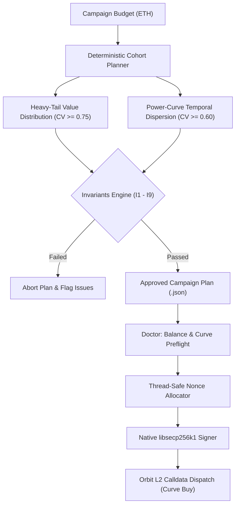

# RobinHidden

[](LICENSE)
[](https://www.python.org/)
[-purple.svg)](https://robinhoodchain.blockscout.com)
[](https://arbitrum.io/orbit)
[](#cryptographic-security-model)
[](selftest.py)

**RobinHidden** is a deterministic cohort engine and privacy-preserving campaign builder designed for **Pons V2** bonding curves on **Robinhood Chain (Arbitrum Orbit L2, Chain ID 4663)**.

It enables multi-wallet accumulation campaigns that systematically conceal token concentration, dismantle on-chain funding linkages, and strictly enforce mathematical hygiene invariants across all transactions.

---

## Table of Contents

- [Overview & Architecture](#overview--architecture)
- [The 9 Hygiene & Invisibility Invariants](#the-9-hygiene--invisibility-invariants)
- [Bonding Curve Mathematics & Concealment](#bonding-curve-mathematics--concealment)
- [Cryptographic Security Model](#cryptographic-security-model)
- [Chain & Verified Protocol Contracts](#chain--verified-protocol-contracts)
- [Installation & Setup](#installation--setup)
- [CLI Command Reference](#cli-command-reference)
- [Verification & Audit Suites](#verification--audit-suites)
- [Threat Model & Inherent Disclosures](#threat-model--inherent-disclosures)
- [License](#license)

---

## Overview & Architecture

Token launches on automated bonding curves often leave obvious telemetry: clustered funding graphs, uniform purchase amounts, identical block timestamps, and large whale wallets on token holder rankings. 

RobinHidden solves this by transforming a single accumulation budget into a **decorrelated stochastic cohort**:



### Key Capabilities

- **Deterministic & Reproducible**: Built on seeded pseudorandom algorithms that produce byte-identical plans across different machines.
- **Concentration Concealment**: Strict 5% wallet hold cap enforcement, heavy-tail size splitting, and anti-twin purchase spacing.
- **On-Chain Graph Severing**: Eliminates intra-cohort transfers, central funding relationships, and common exit points.
- **Micro-Block Dispersion**: Guarantees transactions never share the same 100ms Arbitrum Orbit block.
- **Zero-Fallback Native Cryptography**: Requires native `libsecp256k1` (ECDSA) and Rust/OpenSSL `AES-256-GCM` backends. Never falls back to pure-Python implementations.

---

## The 9 Hygiene & Invisibility Invariants

Every plan is compiled against **9 mathematical assertions**. If any invariant fails, execution is aborted immediately unless an explicit `--dangerously-ignore-invariants` override is passed.

| Invariant | Target Assertion | Defense Mechanism |
| :--- | :--- | :--- |
| **I1: Zero Intra-Cohort Edges** | $\text{Edges}(w_i, w_j) = 0$ | No wallet in the cohort may ever fund, transfer to, or interact with another wallet in the cohort. |
| **I2: Zero Deployer Supply** | $\text{Supply}(\text{deployer}) = 0$ | The launch wallet retains zero token supply, preventing immediate attribution. |
| **I3: Hub Dilution** | $\text{Deg} \ge 500, \text{Share} \le 3\%$ | Funding origins (bridges/CEXs) must have high degree ($\ge 500$) and cohort volume must represent $< 3\%$ of total hub volume. |
| **I4: Independent Provenance** | $\text{Count}(\text{sources}) = N$ | Every wallet in the cohort must trace back to a distinct, non-overlapping funding source. |
| **I5: Temporal Dispersion** | $\text{CV}_{\text{timestamp}} \ge 0.60$ | Transaction intervals are generated along a power curve ($t \propto pos^{1.6}$), destroying uniform periodicity. |
| **I6: Amount Heterogeneity & Cap** | $\text{CV}_{\text{amount}} \ge 0.75$, $\text{Hold} \le 5\%$ | Wallet totals follow a heavy-tail distribution with a hard 5% hold cap and no "twins" (no two amounts within 2%). |
| **I7: Segregated Exits** | $\text{Destinations}(\text{exits}) = N$ | Exits and sweep operations are strictly segregated to distinct target addresses. |
| **I8: Venue Diversity** | Pre-graduation verified | Prevents router fingerprinting; trades directly against the token's active bonding curve. |
| **I9: Inter-Block Spacing** | $\Delta t \ge 3 \text{ blocks}$ ($\ge 300\text{ms}$) | Prohibits multiple cohort transactions from landing in the same Arbitrum Orbit L2 block (100ms block time). |

---

## Bonding Curve Mathematics & Concealment

### Supply & Price Dynamics

Pons V2 curves operate on deterministic bonding mathematics. For an initial curve depth $D$ and total ETH spent $S$:

$$\text{Implied Supply Share } f = \frac{S}{S + D}$$

$$\text{Cost to Acquire Share } f: \quad C(f) = D \cdot \frac{f}{1 - f}$$

$$\text{Average Price Multiplier}: \quad M(f) = \frac{1}{1 - f}$$

| Target Share ($f$) | Cost ($\times D$) | Avg Entry Multiplier | Min Wallets (5% cap) |
| :---: | :---: | :---: | :---: |
| **30%** | $0.429 \times D$ | $1.429 \times$ | 6 |
| **50%** | $1.000 \times D$ | $2.000 \times$ | 10 |
| **55%** | $1.222 \times D$ | $2.222 \times$ | 11 |
| **58% (Standard)** | $1.381 \times D$ | $2.381 \times$ | 12 (uses 25) |
| **65%** | $1.857 \times D$ | $2.857 \times$ | 13 |
| **90%** | $9.000 \times D$ | $10.000 \times$ | 18 |

> **Practical Ceiling**: Attempting to accumulate $>65\%$ triggers exponential slippage ($9\times D$ for 90%) and severe visibility risks. The recommended target is **55% to 65%** across 25+ wallets.

---

## Cryptographic Security Model

RobinHidden enforces strict cryptographic isolation. Pure-Python implementations of ECDSA and AES have been eliminated from the execution path.

```
       [Keystore File (data/wallets.json)]
                       │
             (AES-256-GCM / PBKDF2)
                       │
       ┌───────────────┴───────────────┐
       ▼                               ▼
[OpenSSL Rust/CFFI]           [libsecp256k1 Native]
 Native AES Bridge             Coincurve ECDSA Signer
 (Pinned package hashes)       (Constant-time scalar math)
       │                               │
       └───────────────┬───────────────┘
                       ▼
          [RFC 6979 Deterministic Signatures]
          [EIP-155 / EIP-2718 Orbit Raw Tx]
```

- **Native Signer (`rh/native_secp.py`)**: Uses `Coincurve 21.0.0` bound to `libsecp256k1`. Enforces RFC 6979 deterministic $k$-generation, constant-time scalar multiplication, and validates code integrity against `rh/native_secp_distribution.json`.
- **Native Custody (`rh/native_aes.py`)**: Keystore encryption and decryption require `Cryptography 50.0.2` (Rust-OpenSSL backend). No Python AES fallback is permitted.
- **Strict Isolation**: Both backends check interpreter ABI, package hashes, and runtime environments on startup. If an untrusted or unsupported environment is detected, execution fails closed.

---

## Chain & Verified Protocol Contracts

Verified on **Robinhood Chain (L2 Arbitrum Orbit)** at block `85,271,310`:

| Component | Contract Address | Verified Selector / Details |
| :--- | :--- | :--- |
| **Chain ID** | `4663` | Arbitrum Orbit L2 (100ms block interval) |
| **Public RPC** | `https://rpc.mainnet.chain.robinhood.com` | Standard JSON-RPC |
| **Block Explorer** | `https://robinhoodchain.blockscout.com` | Blockscout Instance |
| **WETH** | `0x0Bd7D308f8E1639FAb988df18A8011f41EAcAD73` | Canonical Wrapped Ether |
| **Factory V2** | `0x7ed598bcef8bd9edd8c97a195c6d13f40801ec7e` | PUSH4 verified, launch fee 0.0005 ETH |
| **Router (Launch & Buy)** | `0xe33e9e479df8802cb0866d5d05258bec4cf62948` | `0xf85f8e41` |
| **Bonding Curve (Buy)** | *Dynamic per token* | `0x59a87bc1` (`buy(uint256,uint256,address)`) |
| **Bonding Curve (Sell)** | *Dynamic per token* | `0xd04c6983` (`sell(uint256,uint256,address)`) |
| **TokenLaunched Topic0** | `0x8d4aad49...` | Verified match with on-chain logs |

---

## Installation & Setup

### Prerequisites

- macOS (arm64 Apple Silicon) or Linux x86_64
- CPython 3.12 (Recommended: isolated environment)

### 1. Clone & Set Up Virtual Environment

```bash
git clone https://github.com/LW-ARTS/RobinHidden.git
cd RobinHidden

# Create Python 3.12 virtual environment
python3.12 -m venv .venv
source .venv/bin/activate
```

### 2. Install Pinned Cryptographic Dependencies

To maintain cryptographic provenance, install from the locked hash files:

```bash
pip install --require-hashes --no-deps -r requirements-signer.lock
pip install --require-hashes --no-deps -r requirements-custody.lock
```

---

## CLI Command Reference

### `main.py plan`

Generates a deterministic campaign plan adhering to all 9 invariants.

```bash
# Standard preset (25 wallets, target 58% supply, seed 1337)
python3 main.py plan --preset standard

# Custom campaign
python3 main.py plan --budget 15.0 --depth 8.0 --wallets 20 --target 0.50 --seed 42
```

### `main.py verify`

Mathematically recomputes and verifies the 9 invariants against an existing plan file:

```bash
python3 main.py verify data/runs/plan-20261015-120000.json
```

### `main.py doctor`

Performs an online preflight check verifying RPC latency, chain ID, gas base fee, bonding curve state, and wallet balances:

```bash
python3 main.py doctor --plan data/runs/plan-20261015-120000.json
```

### `main.py gen`

Generates $N$ cryptographically secure EOA wallets and writes an encrypted keystore (`chmod 600`):

```bash
python3 main.py gen --n 25 --password "YourStrongKeystorePassword"
```

### `main.py run`

Executes the campaign according to planned slots:

```bash
# Dry run: build, simulate, and verify signatures locally without broadcasting
python3 main.py run --plan data/runs/plan-xxx.json --token 0xTargetTokenAddress

# Live broadcast (signs and transmits to Robinhood Chain RPC)
python3 main.py run --plan data/runs/plan-xxx.json --token 0xTargetTokenAddress --send
```

---

## Verification & Audit Suites

The repository includes comprehensive offline test suites that require zero network access and mock external dependencies:

```bash
# Run the core offline self-test suite (79 tests)
python3 selftest.py

# Run the focused cryptographic & native security audit suite (78 tests)
python3 audit/run_native_audit_package.py
```

### Verification Coverage

- **`selftest.py`**: Validates keccak256, RLP encoding, EIP-155 transaction construction, curve pricing, invariant assertions, and plan reproducibility.
- **`audit/test_native_signer.py`**: Verifies `libsecp256k1` RFC 6979 vectors, signature canonicality ($s < N/2$), and public-key recovery.
- **`audit/test_native_aes.py`**: Verifies NIST SP 800-38D AES-GCM known-answer vectors, MAC failure handling, and PBKDF2 iterations.
- **`audit/test_custody_verifier.py`**: Audits keystore file permissions, memory hygiene, and permission isolation.

---

## Threat Model & Inherent Disclosures

While RobinHidden severs on-chain links and disperses wallet behavior, users must understand the boundaries of on-chain privacy:

1. **Centralized Funding Entity**: If all wallets are funded from a single CEX account or sub-account, the funding entity (and subpoenaed logs) can link the wallets off-chain.
2. **Network Layer (IP Addresses)**: If all transactions are broadcast to the RPC from a single residential IP without proxy rotation, the RPC node provider can correlate transactions via network metadata.
3. **Token Concentration Metrics**: On-chain explorers show individual token balances. Even if wallets appear unrelated, cumulative cohort percentage remains visible on global holder distribution charts.
4. **Time-Travel Analysis**: Advanced statistical heuristic engines analyzing token transfers post-graduation may detect cohort liquidation patterns if wallets sweep to common destinations (prohibited by Invariant **I7**).

---

## License

This project is licensed under the [MIT License](LICENSE).
